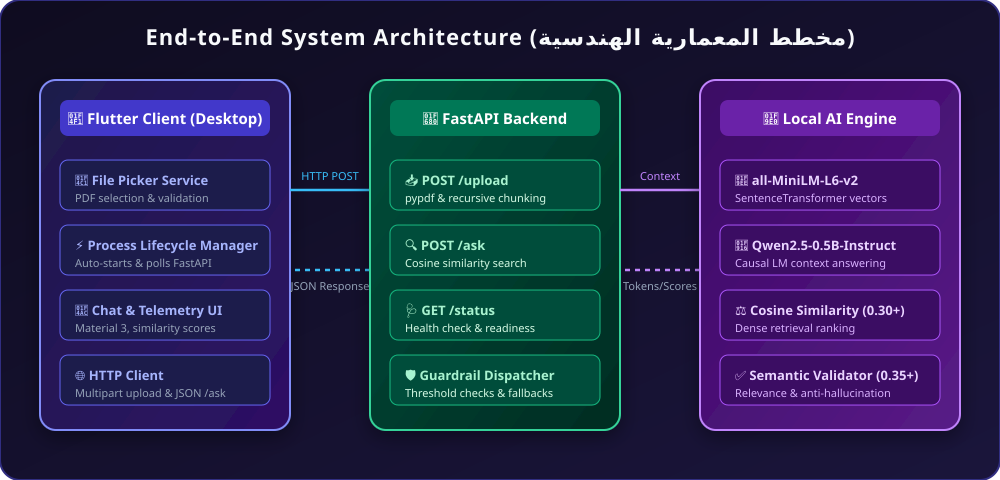
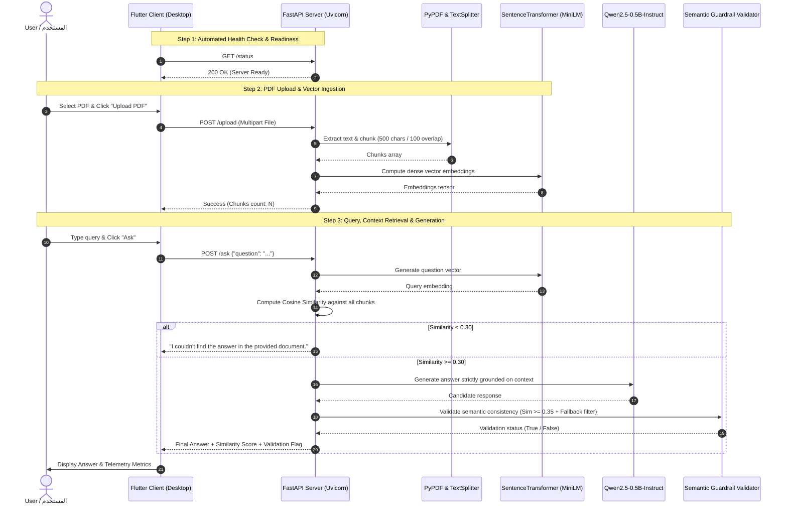

<div align="center">

  

  <br/><br/>

  <h1>Local RAG App — PDF Assistant</h1>
  <p>
    <strong>Next-Generation 100% Offline Document Intelligence &amp; Question-Answering Application</strong><br/>
    <em>مساعد المستندات الذكي المعتمد على تقنية الاسترجاع المعزز بالتوليد (RAG) محلياً بدون إنترنت</em>
  </p>

  <p align="center">
    <a href="#-overview"></a>
    <a href="#-overview"></a>
    <a href="#-ai-models--rag-pipeline"></a>
    <a href="#-ai-models--rag-pipeline"></a>
    <a href="#-key-features"></a>
    <a href="#-license"></a>
  </p>

  <p align="center">
    <a href="#-overview">Overview</a> •
    <a href="#-key-features">Key Features</a> •
    <a href="#-system-architecture">System Architecture</a> •
    <a href="#-ai-models--rag-pipeline">AI Pipeline</a> •
    <a href="#-quick-start--installation">Quick Start</a> •
    <a href="#-api-reference">API Reference</a> •
    <a href="#-about-the-developer">About the Developer</a>
  </p>

</div>

---

## 📌 Overview | نظرة عامة

### English
**Local RAG App (PDF Assistant)** is an end-to-end, privacy-first desktop application combining an elegant **Flutter (Material 3)** client with a high-performance local **FastAPI & PyTorch** backend. 

The application is engineered to operate **completely offline (100% Local / On-Device)**. It guarantees that sensitive PDFs never leave the host machine. By leveraging state-of-the-art **Retrieval-Augmented Generation (RAG)**, dense semantic embeddings, and an in-memory vector similarity engine, users can query any document and receive instant, fact-grounded answers powered by a strictly constrained local language model (`Qwen2.5-0.5B-Instruct`), fortified by an automated **Semantic Answer Validation Guardrail**.

### العربية
تطبيق **Local RAG App** هو نظام متكامل ومحلي بالكامل يجمع بين واجهة مستخدم مكتبية حديثة مبنية بـ **Flutter (Material 3)** وخادم ذكاء اصطناعي محلي معتمد على **FastAPI** و **PyTorch** ونماذج **HuggingFace**.

يعمل النظام دون أي اتصال خارجي بالإنترنت لحماية خصوصية المستندات 100%. يوفر استخراجاً دقيقاً للنصوص، وتقطيعاً دلالياً، ومحرك بحث بتشابه جيب التمام، مع توليد الإجابات عبر نموذج `Qwen2.5` وطبقة تحقق تمنع الهلوسة.

<div align="center">
  
</div>

---

## 🚀 Key Features | المميزات الرئيسية

- **⚡ Automatic Backend Lifecycle Management:**  
  The Flutter client automatically spawns the local Python FastAPI server (`uvicorn`) upon launch, monitors server health via periodic status polling, and cleanly terminates the process when exited.
  *(إدارة دورة حياة الخادم تلقائياً عند فتح وإغلاق التطبيق).*

- **📄 Robust Document Ingestion & Chunking:**  
  Extracts Arabic and English text using `pypdf`, chunked with `langchain_text_splitters.RecursiveCharacterTextSplitter` (chunk size: `500` characters, overlap: `100` characters) for coherent semantic preservation.
  *(تقطيع المستندات بذكاء مع تداخل دلالي للحفاظ على ترابط المعنى).*

- **🔍 Dense Vector Semantic Retrieval:**  
  Converts text chunks into dense numeric vectors using `sentence-transformers/all-MiniLM-L6-v2`. Computes cosine similarity with a minimum confidence threshold (`>= 0.30`) to retrieve only the most relevant context.
  *(محرك استرجاع دلالي كثيف بتشابه جيب التمام).*

- **🧠 Local LLM Generation (Zero Cloud Dependency):**  
  Employs `Qwen/Qwen2.5-0.5B-Instruct` run natively on local CPU/GPU with PyTorch. Prompted with strict grounding rules to eliminate extrapolation and external knowledge hallucinations.
  *(توليد إجابات دقيقة ومقيدة بالسياق فقط دون أي استهلاك لواجهات سحابية).*

- **🛡️ Multi-Tier Semantic Guardrail & Anti-Hallucination:**  
  Validates generated answers against the source context using a secondary cosine similarity check (`>= 0.35`) and scans for fallback rejection phrases.
  *(صمام أمان وتحقق دلالي لضمان مصداقية الإجابات).*

- **📊 Real-Time Telemetry & Confidence Scoring:**  
  Displays chunk counts, cosine similarity scores, validation statuses, and error diagnostics directly in the UI.
  *(عرض مباشر لمؤشرات الدقة ودرجة التشابه في واجهة المستخدم).*

---

## 🏗 System Architecture | المعمارية الهندسية



---

## 🧠 AI Models & RAG Pipeline | نماذج الذكاء الاصطناعي

| Component | Model / Technology | Parameters / Dimension | Purpose & Description |
|:---|:---|:---:|:---|
| **Text Chunking** | `langchain_text_splitters` | Chunk: `500` / Overlap: `100` | Splits PDF stream into contextually balanced segments |
| **Embedding Model** | `sentence-transformers/all-MiniLM-L6-v2` | `384` dimensions | Fast, high-accuracy dense vector representations |
| **Retrieval Engine** | `sklearn.metrics.pairwise.cosine_similarity` | `threshold = 0.30` | In-memory similarity ranking for top context selection |
| **Generative LLM** | `Qwen/Qwen2.5-0.5B-Instruct` | `0.5 Billion` parameters | Lightweight local LLM instructed to answer exclusively from context |
| **Semantic Validator** | `SentenceTransformer` + Fallback Filter | `threshold = 0.35` | Anti-hallucination verification comparing answer vs context |

---

## 📥 Quick Start & Installation | دليل التثبيت والتشغيل

### Prerequisites
* **Python 3.10+**: Installed and available in your system `PATH`.
* **Flutter SDK (3.11+)**: Installed and configured for Windows Desktop development.
* **Visual Studio C++ Build Tools** (for Flutter Windows Desktop compilation).

---

### Step 1: Setup Local Python Backend

```bash
# 1. Navigate to the backend directory
cd bac/rag-prototype

# 2. Create and activate a virtual environment
python -m venv .venv

# On Windows PowerShell:
.venv\Scripts\Activate.ps1
# On Windows CMD:
.venv\Scripts\activate.bat

# 3. Upgrade pip and install all required dependencies
pip install --upgrade pip
pip install -r requirements.txt
```

> 💡 **Note:** Flutter automatically manages starting the FastAPI backend when the app opens. However, you can also run it independently for testing:
> ```bash
> uvicorn api:app --host 127.0.0.1 --port 8000 --reload
> ```

---

### Step 2: Run Flutter Desktop Application

```bash
# 1. Return to the root of the project
cd ../..

# 2. Fetch Dart dependencies
flutter pub get

# 3. Run the Windows Desktop app
flutter run -d windows
```

Once launched:
1. The backend indicator turns green: **"RAG server is ready"**.
2. Click **"Choose PDF"** to pick your document.
3. Click **"Upload PDF"** to extract text and build vectors.
4. Type your question and click **"Ask"** to receive instantaneous, verified answers!

---

## ⚙️ API Reference | توثيق نقاط الاتصال

Default Local Base URL: `http://127.0.0.1:8000`

### 1. Root Health Check
* **`GET /`**
* **Response:**
  ```json
  {
    "message": "PDF RAG Assistant API is running"
  }
  ```

### 2. Document Status
* **`GET /status`**
* **Response:**
  ```json
  {
    "ready": true,
    "message": "PDF is ready for questions."
  }
  ```

### 3. Upload & Ingest PDF
* **`POST /upload`**
* **Content-Type:** `multipart/form-data`
* **Response:**
  ```json
  {
    "message": "PDF uploaded successfully.",
    "filename": "document.pdf",
    "chunks": 42
  }
  ```

### 4. Query Document
* **`POST /ask`**
* **Content-Type:** `application/json`
* **Body:**
  ```json
  {
    "question": "What are the main results highlighted in the report?"
  }
  ```
* **Response:**
  ```json
  {
    "answer": "The report highlights high speed, data security, and Arabic support.",
    "similarity": 0.8124,
    "validated": true,
    "source": 1
  }
  ```

---

## 📁 Project Structure | هيكل المشروع

```text
Local-rag-app/
├── assets/
│   └── branding/                 # Visual identity & developer signature
│       ├── banner.svg            # High-res project banner
│       ├── logo.svg              # Vector app emblem
│       ├── architecture.svg      # Interactive architecture diagram
│       ├── khawlah-signature-animated.gif # Animated floral signature
│       └── khawlah-signature.png # Static developer signature
├── bac/
│   └── rag-prototype/            # Local FastAPI & AI Engine
│       ├── api.py                # FastAPI endpoints & routing
│       ├── chunker.py            # Text splitting algorithms
│       ├── embedder.py           # Vector embeddings generator
│       ├── generated.py          # Qwen2.5 LLM inference & prompting
│       ├── pdf_reader.py         # PyPDF text extraction
│       ├── retriever.py          # Cosine similarity retrieval
│       ├── answer_validator.py   # Anti-hallucination guardrail
│       └── requirements.txt      # Python dependencies
├── lib/
│   └── main.dart                 # Flutter UI & Backend process manager
├── pubspec.yaml                  # Flutter package & assets manifest
├── analysis_options.yaml         # Linter rules
└── README.md                     # Comprehensive project documentation
```

---

<!-- 🌸 KHAWLAH AL-HEBSHI — DEVELOPER SIGNATURE -->
## 👩‍💻 About the Developer | عن المطوّرة

<div align="center">

  

  <br/>

  

  <br/><br/>

  <a href="https://github.com/khowlah">
    
  </a>
  <a href="https://linkedin.com/in/khawlah-al-hebshi-12046a38a">
    
  </a>
  <a href="https://khowlah.github.io/Myprotofile">
    
  </a>

  <br/><br/>

  
  
  
  

  <br/><br/>

  <i>Designed with curiosity. Built with purpose.</i>
  <br/>
  <sub>✦ A little signature from Khawlah ✦</sub>

</div>

<br/>

### English
I'm **Khawlah Al-Hebshi**, a Software Engineering graduate working across backend development with **Next.js** and cross-platform applications with **Flutter**. I bring together software engineering, product thinking, and AI-assisted workflows to build practical, impactful digital experiences.

I use AI and vibe coding as core accelerators in the development process, while keeping relentless focus on clean architecture, sound problem-solving, and products that serve real human needs.

### العربية
أنا **خولة الحيشي**، خريجة هندسة برمجيات أعمل على تطوير الأنظمة الخلفية عبر **Next.js** والتطبيقات متعددة المنصات عبر **Flutter**. أدمج بين المبادئ الهندسية المتينة، والتفكير المتمحور حول المنتج، ومسارات العمل المدعومة بالذكاء الاصطناعي لبناء تجارب رقمية عملية ومتقنة.

أعتمد على الذكاء الاصطناعي وتقنيات البرمجة التفاعلية (Vibe Coding) كأدوات تسريع وتطوير فعالة، مع التركيز الدائم على الهيكلة البرمجية النظيفة، والحل المبتكر للمشكلات، وتطوير منتجات تخدم الاحتياجات الحقيقية.

---

## 📄 License | الترخيص

This project is open-source and distributed under the **MIT License**. See the `LICENSE` file for more details.

<div align="center">
  <sub>Built with care &amp; precision by Khawlah Al-Hebshi 🚀</sub><br/>
  <a href="#local-rag-app--pdf-assistant">Back to Top ⬆️</a>
</div>
