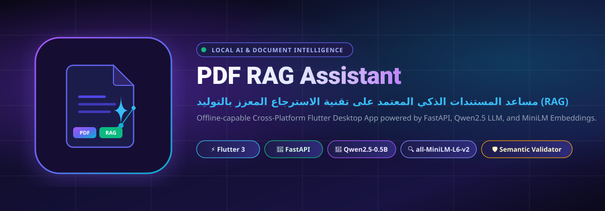
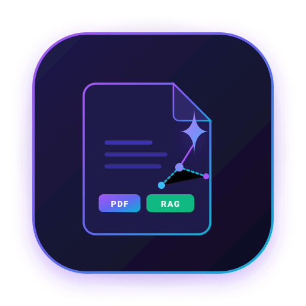
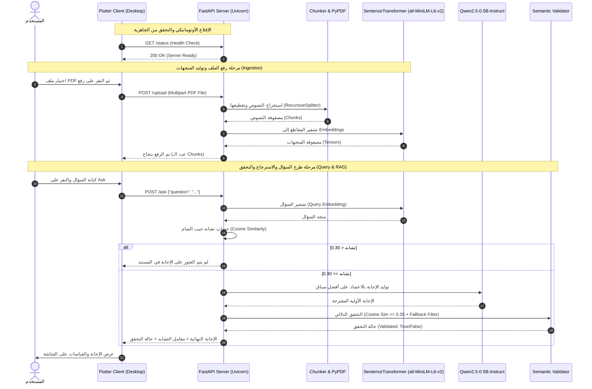

<div align="center">

  

  <br/>

  <p align="center">
    <strong>مساعد المستندات الذكي المعتمد على تقنية الاسترجاع المعزز بالتوليد (RAG) بدون إنترنت</strong><br/>
    <em>Next-Generation Offline Document Intelligence &amp; Question-Answering Application</em>
  </p>

  <p align="center">
    <a href="#-نظرة-عامة-overview"></a>
    <a href="#-نظرة-عامة-overview"></a>
    <a href="#-نماذج-الذكاء-الاصطناعي-ai-models--pipeline"></a>
    <a href="#-نماذج-الذكاء-الاصطناعي-ai-models--pipeline"></a>
    <a href="#-الهوية-البصرية-visual-identity"></a>
    
  </p>

  <p align="center">
    <a href="#-نظرة-عامة-overview">نظرة عامة</a> •
    <a href="#-الهوية-البصرية-visual-identity">الهوية البصرية</a> •
    <a href="#-المميزات-الرئيسية-key-features">المميزات الرئيسية</a> •
    <a href="#-المعمارية-الهندسية-system-architecture">المعمارية الهندسية</a> •
    <a href="#-نماذج-الذكاء-الاصطناعي-ai-models--pipeline">نماذج الذكاء الاصطناعي</a> •
    <a href="#-دليل-التثبيت-والتشغيل-installation--quick-start">دليل التشغيل</a> •
    <a href="#-توثيق-واجهة-api-reference">توثيق الـ API</a>
  </p>

</div>

---

## 📌 نظرة عامة (Overview)

تطبيق **PDF RAG Assistant** هو حل متكامل وقوي يجمع بين واجهة مستخدم مكتبية حديثة مبنية بإطار العمل **Flutter (Material 3)**، وخادم ذكاء اصطناعي محلي فائق السرعة معتمد على **FastAPI** و **PyTorch** و **HuggingFace Transformers**. 

تم تصميم التطبيق ليعمل بكفاءة وسرعة **محلياً بالكامل (100% Offline / On-Device)** دون الحاجة إلى إرسال أي مستندات أو بيانات حساسة إلى واجهات خارجية (مثل OpenAI أو Google Cloud). يعتمد النظام على تقنية **الاسترجاع المعزز بالتوليد (RAG - Retrieval-Augmented Generation)** للإجابة على الأسئلة الدقيقة الموجهة إلى مستندات الـ PDF مع طبقة تحقق دلالي متطورة لمنع الهلوسة (Anti-Hallucination Guardrail).

<div align="center">
  
</div>

---

## 🎨 الهوية البصرية (Visual Identity)

تم بناء الهوية البصرية للمشروع بعناية لتعكس **الحداثة، الذكاء، والموثوقية التقنية**، مع دمج تدرجات الألوان العميقة والمستقبلية (Deep Cyber & AI Violet Palette):

<p align="center">
  
</p>

### 1. فلسفة الشعار (Logo Concept)
- **رمز المستند الذكي:** يعبر عن معالجة وقراءة ملفات الـ PDF والبيانات النصية بدقة.
- **الشبكة العصبية والبريق الذكي (Neural Spark):** يرمز إلى الاستدلال وتوليد الإجابات الذكية بواسطة نموذج اللغة Qwen2.5.
- **تدرج الألوان المتصل (Gradient Wave):** يعكس التدفق السلس للمعلومات من مرحلة الاستخراج إلى التضمين ثم الاسترجاع والتحقق.

### 2. لوحة الألوان الرسمية (Color Palette)

| اللون | كود Hex | الوظيفة الدلالية | الاستخدام في الواجهة |
|:---:|:---:|:---:|:---|
|  | `#1E1B4B` | **Deep Slate Navy** | الخلفيات الأساسية والعناصر المحيطية |
|  | `#6750A4` | **Royal Violet** | اللون الأساسي للتطبيق (Primary Seed) والأزرار التفاعلية |
|  | `#06B6D4` | **Electric Cyan** | مؤشرات التقدم، الروابط، وأبرز الإحصائيات |
|  | `#10B981` | **Emerald Green** | إشارة جاهزية الخادم وحالة التحقق الإيجابي (Validated) |
|  | `#F59E0B` | **Amber Warning** | شارة بدء التشغيل والانتظار لمعالجة المستند |
|  | `#EF4444` | **Crimson Alert** | رسائل الخطأ والاستفسارات غير المتطابقة دلالياً |

### 3. أسلوب الواجهات (UI/UX Principles)
- **Material 3 Design Tokens:** تدرج هرمي واضح للحقول والبطاقات (Cards) مع حواف مستديرة (12-16px).
- **Instant Telemetry Display:** عرض مباشر لدرجة التشابه (Cosine Similarity Score) وحالة التحقق من المصدر فور استلام الإجابة.
- **Non-blocking Reactive States:** استجابة فورية لحالة رفع الملف، وجاهزية الموديل مع مؤشرات تحميل واضحة.

---

## 🚀 المميزات الرئيسية (Key Features)

- **⚡ إدارة تلقائية كاملة للباكيند (Lifecycle Process Auto-Start):**
  يقوم تطبيق Flutter عند الإقلاع بتشغيل خادم FastAPI في الخلفية تلقائياً واختبار استجابته عبر فحص دوري، وإنهاء العملية بأمان عند إغلاق التطبيق.

- **📄 معالجة وتقطيع المستندات بذكاء (Document Ingestion Engine):**
  استخراج النصوص العربية والإنجليزية عبر مكتبة `pypdf`، ثم تجزئة المحتوى إلى كتل نصية دقيقة عبر `RecursiveCharacterTextSplitter` مع تداخل دلالي (Chunk Size: 500, Overlap: 100).

- **🔍 استرجاع دلالي كثيف (Dense Semantic Retrieval):**
  تحويل النصوص إلى متجهات عددية عبر نموذج التضمين العالمي `all-MiniLM-L6-v2`، ومطابقة الأسئلة مع أفضل المقاطع بواسطة خوارزمية جيب التمام (Cosine Similarity) مع حد أدنى للقبول (Threshold >= 0.30).

- **🧠 توليد محلي عالي الكفاءة (Local LLM Inference):**
  الاعتماد على نموذج `Qwen/Qwen2.5-0.5B-Instruct` المحسن للاستجابة المباشرة والالتزام الصارم بسياق المستند دون اختلاق أو تخمين.

- **🛡️ طبقة حماية وتحقق مانعة للهلوسة (Semantic Answer Validator):**
  فلترة الإجابة الناتجة ومقارنة معناها مع السياق الأصلي (Answer-Context Similarity >= 0.35)، مع رصد عبارات التراجع التلقائي لضمان عدم تقديم إجابات مضللة.

- **📊 قياسات حية ومؤشرات دقيقة (Real-time Telemetry):**
  عرض نسبة التشابه، وحالة التحقق الدلالي، وعدد الـ Chunks التي تم توليدها للملف مباشرة في واجهة المستخدم.

---

## 🏗 المعمارية الهندسية (System Architecture)



---

## 🧠 نماذج الذكاء الاصطناعي (AI Models & Pipeline)

| المرحلة | النموذج / التقنية المستخدمة | الدور الهندسي | المواصفات |
|:---|:---|:---|:---|
| **تجزئة النصوص** | `langchain_text_splitters` | تقسيم المستندات الطويلة مع الحفاظ على ترابط المعنى | `chunk_size = 500`<br/>`chunk_overlap = 100` |
| **نموذج التضمين** | `sentence-transformers/all-MiniLM-L6-v2` | تحويل المقاطع النصية إلى متجهات كثيفة (Dense Vectors) | أبعاد المتجه: `384`<br/>سريع جداً على المعالج المركزي (CPU) |
| **محرك الاسترجاع** | `sklearn.metrics.pairwise.cosine_similarity` | البحث التناظري بين السؤال ومقاطع المستند | `MIN_SIMILARITY = 0.30`<br/>اختيار أفضل سياق بدقة |
| **نموذج التوليد (LLM)** | `Qwen/Qwen2.5-0.5B-Instruct` | صياغة إجابة مباشرة ودقيقة استناداً إلى السياق فقط | بارامترات: `0.5 Billion`<br/>يعمل على الذاكرة المحلية بدون GPU خارجي |
| **طبقة التحقق** | `Semantic Validator` | مطابقة الإجابة المنتجة بالسياق وتصفية أي هلوسة | `MIN_ANSWER_SIMILARITY = 0.35`<br/>استبعاد عبارات الرفض والشك |

---

## 📥 دليل التثبيت والتشغيل (Installation & Quick Start)

### المتطلبات الأساسية (Prerequisites)
1. **Python 3.10 أو أحدث**: مثبت ومضاف إلى متغيرات البيئة (`PATH`).
2. **Flutter SDK (3.11+)**: مثبت وجاهز لتطوير تطبيقات سطح المكتب.
3. **أدوات C++ لسطح المكتب (Visual Studio C++ Build Tools)** إذا كنت تشغل المشروع على بيئة Windows.

---

### أولاً: إعداد خادم الذكاء الاصطناعي (Backend Setup)

1. انتقل إلى مجلد الباكيند:
   ```bash
   cd rag_pdf_app/bac/rag-prototype
   ```

2. أنشئ بيئة بايثون افتراضية وقم بتفعيلها:
   ```bash
   # إنشاء البيئة
   python -m venv .venv

   # التفعيل على Windows PowerShell
   .venv\Scripts\Activate.ps1

   # أو على CMD
   .venv\Scripts\activate.bat
   ```

3. قم بتثبيت المكتبات المطلوبة:
   ```bash
   pip install --upgrade pip
   pip install -r requirements.txt
   ```

4. *(اختياري)* يمكنك اختبار تشغيل الخادم منفرداً للتحقق:
   ```bash
   uvicorn api:app --host 127.0.0.1 --port 8000 --reload
   ```
   > 💡 **ملاحظة:** عند تشغيل التطبيق عبر Flutter، يقوم تطبيق Flutter بتشغيل هذا الأمر تلقائياً دون الحاجة لتشغيله يدوياً!

---

### ثانياً: تشغيل تطبيق الواجهة (Flutter Frontend)

1. عد إلى المجلد الرئيسي لمشروع Flutter:
   ```bash
   cd rag_pdf_app
   ```

2. قم بتثبيت حزم Dart و Flutter:
   ```bash
   flutter pub get
   ```

3. شغّل التطبيق لسطح المكتب (Windows Desktop):
   ```bash
   flutter run -d windows
   ```

4. بمجرد فتح التطبيق:
   - ستظهر حالة الخادم خضراء: `RAG server is ready`.
   - انقر على زر **"Choose PDF"** لاختيار أي مستند تريد الاستفسار عنه.
   - انقر على **"Upload PDF"** ليتم تقطيع الملف وتوليد المتجهات له.
   - اكتب سؤالك في خانة السؤال وانقر على **"Ask"** للحصول على الإجابة مع مؤشر دقة التشابه وحالة التحقق!

---

## ⚙️ توثيق واجهة (API Reference)

يعمل الخادم المحلي على العنوان الافتراضي: `http://127.0.0.1:8000`

### 1. فحص الصحة العامة (Root Check)
- **Endpoint:** `GET /`
- **Response:**
  ```json
  {
    "message": "PDF RAG Assistant API is running"
  }
  ```

### 2. حالة جاهزية المستند (Document Status)
- **Endpoint:** `GET /status`
- **Response:**
  ```json
  {
    "ready": true,
    "message": "PDF is ready for questions."
  }
  ```

### 3. رفع ومعالجة الـ PDF (Upload Document)
- **Endpoint:** `POST /upload`
- **Content-Type:** `multipart/form-data`
- **Payload:** `file: [your_document.pdf]`
- **Response:**
  ```json
  {
    "message": "PDF uploaded successfully.",
    "filename": "document.pdf",
    "chunks": 42
  }
  ```

### 4. الاستعلام وطرح الأسئلة (Ask Question)
- **Endpoint:** `POST /ask`
- **Content-Type:** `application/json`
- **Payload:**
  ```json
  {
    "question": "ما هي الميزات الأساسية المذكورة في التقرير؟"
  }
  ```
- **Response:**
  ```json
  {
    "answer": "الميزات الأساسية تشمل السرعة العالية، والأمان، ودعم اللغة العربية.",
    "similarity": 0.7842,
    "validated": true,
    "source": 1
  }
  ```

---

## 📁 هيكل المشروع (Project Directory Tree)

```text
rag_pdf_app/
├── assets/
│   └── branding/                 # أصول الهوية البصرية الرسمية
│       ├── banner.svg            # بانر العرض والواجهة الرئيسية
│       ├── logo.svg              # شعار وأيقونة المشروع الرسمية
│       └── architecture.svg      # مخطط المعمارية الهندسية التفاعلي
├── bac/
│   └── rag-prototype/            # الباكيند المحلي ومحركات الذكاء الاصطناعي
│       ├── api.py                # خادم FastAPI وتوجيه الطلبات
│       ├── chunker.py            # تقسيم وتجزئة النصوص
│       ├── embedder.py           # إنشاء متجهات التضمين
│       ├── generated.py          # استدعاء نموذج Qwen2.5 وتوليد الإجابات
│       ├── pdf_reader.py         # استخراج النصوص من ملفات PDF
│       ├── retriever.py          # محرك البحث الدلالي وحساب تشابه جيب التمام
│       ├── answer_validator.py   # صمام الأمان والتحقق لمنع الهلوسة
│       └── requirements.txt      # التبعيات البرمجية لبايثون
├── lib/
│   └── main.dart                 # واجهة المستخدم المبنية بفلاتر وإدارة دورة حياة الخادم
├── pubspec.yaml                  # إعدادات وتبعية مشروع Flutter
├── analysis_options.yaml         # قواعد الفحص والترميز لـ Dart
└── README.md                     # التوثيق الشامل للمشروع
```

---

## 🛡️ طبقة الحماية الدلالية (Semantic Guardrail)

لمنع مشاكل الهلوسة الشائعة في النماذج اللغوية، يطبق **PDF RAG Assistant** نظام تحقق متعدد المستويات:
1. **فلترة عبارات عدم المعرفة:** استبعاد إجابات التردد والرفض عبر قائمة عبارات مخصصة (`FALLBACK_PHRASES`).
2. **التحقق من التشابه الدلالي بين الإجابة والسياق:** استخدام `validator_model` لحساب التشابه بين الإجابة المولدة وسياق الفقرة المسترجعة من الـ PDF، بحيث ترفض الإجابة إذا قل التشابه عن `0.35`.
3. **تنبيه المستخدم الواضح:** إذا لم يتطابق السؤال مع محتوى المستند أو فشل التحقق، يستجيب النظام برسالة صريحة توضح أن المعلومة غير متوفرة في المستند المقدم بدلاً من توليد إجابة خاطئة.

---

## 🤝 المساهمة والتطوير (Contributing)

نرحب بكافة المساهمات والأفكار لتطوير هذا المشروع! يمكنك المساعدة في:
- إضافة دعم لقواعد بيانات المتجهات الدائمة مثل (ChromaDB / SQLite Vector).
- دعم معالجة عدة ملفات PDF في وقت واحد (Multi-Document Ingestion).
- تمكين البث المباشر للكلمات (Streaming Token Generation).

1. قم بعمل Fork للمستودع.
2. أنشئ فرعاً لميزتك (`git checkout -b feature/AmazingFeature`).
3. سجّل التعديلات (`git commit -m 'Add some AmazingFeature'`).
4. ارفع الفرع إلى GitHub (`git push origin feature/AmazingFeature`).
5. افتح طلب دمج (Pull Request).

---

## 📄 الترخيص (License)

هذا المشروع مرخص تحت رخصة **MIT** - يمكنك الاطلاع على ملف التراخيص لمزيد من التفاصيل والاستخدام الحر.

<div align="center">
  <p>صُمم وتطور بكل إتقان 🚀</p>
  <a href="#-نظرة-عامة-overview">الرجوع لأعلى الصفحة ⬆️</a>
</div>
